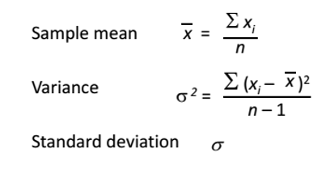

# Introduction to Data Mining

*Lab 2: Evaluation*

## 2.1. Be a classifier

In the second class, we are going to learn how to use datasets to evaluate data mining algorithms in Weka. (See the lecture of class 2 by Ian H. Witten, \[1][^1])

**Interactive decision tree construction**

- Follow the instruction in \[1] to see how decision trees are created for different combinations of attributes in a dataset. Firstly, a dataset and a training set are selected. Secondly, we choose and start running UserClassifier to see a decision tree in the Tree Visualizer. In the Data Visualizer, thirdly, the attributes to use for X and Y are selected, we then select instances in a region in the graph and submit. At this point, the Tree Visualizer shows the tree.
- Examine iris.2D.arff dataset to draw a decision tree for the following pair of attributes by selecting and submitting classes one by one, then remark how many instances are predicted correctly.

| **Attributes** | Split on ***petallength*** and ***petalwidth*** |
| --- | --- |
| **Decision Tree** |  |
| **Remark** |  |

Build a tree, what strategy do you use?

Can you build a “perfect” tree?

## 2.2. Training and testing

The lecture of evaluation (see \[1]-2.2)

Follow the instructions in \[1]-2.3: use **J48** to analyze ionosphere.arff dataset, and write down how accuracy it can achieve with different seeds. (If a random number seed is provided, the dataset will be shuffled before the subset is extracted.)

|  |  |  |  |
| --- | --- | --- | --- |
| **Random number seeds** | **Percent accuracy (x)** | **Random number seeds** | **Percent accuracy (x)** |
| 1 |  | 6 |  |
| 2 |  | 7 |  |
| 3 |  | 8 |  |
| 4 |  | 9 |  |
| 5 |  | 10 |  |
| **Evaluation** | *Sample Mean* |  |  |
|  | *Standard deviation* |  |  |

*Note:*

Remark? -

## 2.3. Baseline accuracy

Follow the instructions in \[1]-2.4 to run some classifiers for breast-cancer.arff dataset:

| **Classifier** | **Accuracy** |
| --- | --- |
| J48 |  |
| NaiveBayes |  |
| IBk |  |
| PART |  |
| ZeroR |  |

What is Baseline accuracy? -

For unbalanced.arff dataset

| **Classifier** | **Accuracy** |
| --- | --- |
| ZeroR |  |
| J48 |  |
| NaiveBayes |  |
| IBk |  |
| PART |  |

Why do the classifiers achive lower accuracy? –

## 2.4. Cross-validation

The *holdout* procedure: a certain amount is held over for testing and the remainder used for training.

*Stratification*: each class is properly represented in both training and test sets.

The *repeated holdout* method of error rate estimation: In each iteration a certain proportion, say two-thirds, of the data is randomly selected for training (using different random-number seeds), possibly with *stratification*, and the remainder is used for testing. The error rates on the different iterations are averaged to yield an  overall error rate.

The lecture of cross validation, 10-fold cross-validation, stratified cross-validation (see \[1]-2.5).

In *cross-validation*, you decide on a fixed number of folds, or partitions, of the data. Suppose we use three. Then the data is split into three approximately equal partitions; each in turn is used for testing and the remainder is used for training. That is, use two-thirds of the data for training  and one-third for testing, and repeat the procedure three times so that in the end, every instance has been used exactly once for testing. This is called *three-fold cross-validation*, and if stratification is adopted as well—which it often is—it is *stratified three-fold cross-validation*.

Weka does stratified cross-validation by default.

Follow the instructions in \[1]-2.5, and examine **J48** on credit-g.arff dataset.

|  |  |  |  |
| --- | --- | --- | --- |
| **Holdout (10%)** | **Percent accuracy (x)** | **10-fold cross-validation** | **Percent accuracy (x)** |
| Random seed: 1 |  | Random seed: 1 |  |
| --              2 |  | --              2 |  |
| --              3 |  | --              3 |  |
| --              4 |  | --              4 |  |
| --              5 |  | --              5 |  |
| --              6 |  | --              6 |  |
| --              7 |  | --              7 |  |
| --              8 |  | --              8 |  |
| --              9 |  | --              9 |  |
| --             10 |  | --             10 |  |
| *Sample Mean* |  | *Sample Mean* |  |
| *Standard deviation* |  | *Standard deviation* |  |

Examine **PART** on credit-g.arff dataset:

|  |  |  |  |
| --- | --- | --- | --- |
| **Holdout (10%)** | **Percent accuracy (x)** | **10-fold cross-validation** | **Percent accuracy (x)** |
| Random seed: 1 |  | Random seed: 1 |  |
| --              2 |  | --              2 |  |
| --              3 |  | --              3 |  |
| --              4 |  | --              4 |  |
| --              5 |  | --              5 |  |
| --              6 |  | --              6 |  |
| --              7 |  | --              7 |  |
| --              8 |  | --              8 |  |
| --              9 |  | --              9 |  |
| --             10 |  | --             10 |  |
| *Sample Mean* |  | *Sample Mean* |  |
| *Standard deviation* |  | *Standard deviation* |  |

Examine **NaiveBayes** on credit-g.arff dataset:

|  |  |  |  |
| --- | --- | --- | --- |
| **Holdout (10%)** | **Percent accuracy (x)** | **10-fold cross-validation** | **Percent accuracy (x)** |
| Random seed: 1 |  | Random seed: 1 |  |
| --              2 |  | --              2 |  |
| --              3 |  | --              3 |  |
| --              4 |  | --              4 |  |
| --              5 |  | --              5 |  |
| --              6 |  | --              6 |  |
| --              7 |  | --              7 |  |
| --              8 |  | --              8 |  |
| --              9 |  | --              9 |  |
| --             10 |  | --             10 |  |
| *Sample Mean* |  | *Sample Mean* |  |
| *Standard deviation* |  | *Standard deviation* |  |

[^1]: http://www.cs.waikato.ac.nz/ml/weka/mooc/dataminingwithweka/
